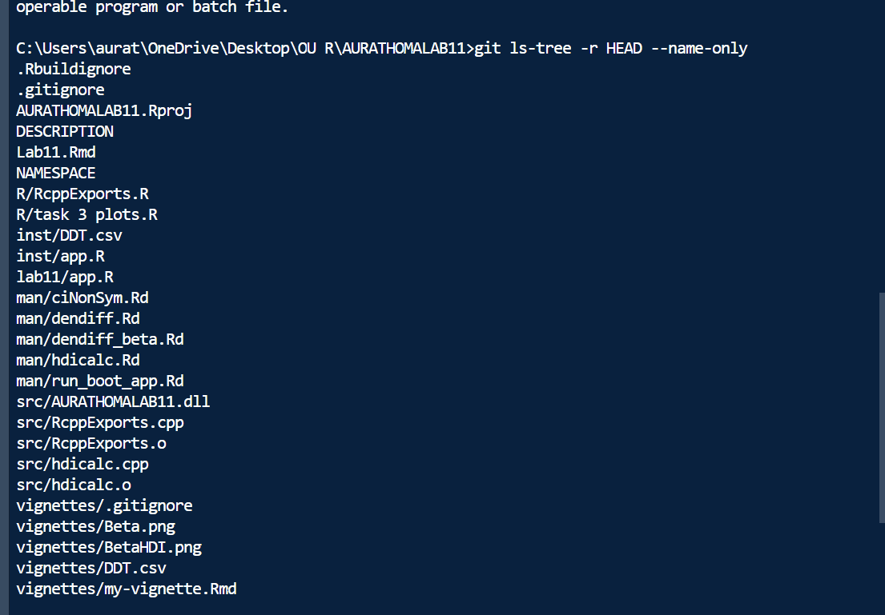

```{r, include = FALSE}
knitr::opts_chunk$set(
  collapse = TRUE,
  comment = "#>"
)
```

```{r setup}
library(AURATHOMALAB11)
```

# Task 1 {-}

```{r}
library(dplyr)
library(ggplot2)
ddt<-read.csv("DDT.csv")
df <- ddt %>% filter(SPECIES == "CCATFISH")
ciNonSym(x = df$LENGTH, 
         alpha = 0.05, 
         alpha2 = 0.02, 
         mu0 = 45, 
         epsilon = 4, 
         bins = 25)
```


# Task 2 {-}
```{r, eval=FALSE}
run_boot_app()
```

# Task 3 {-}

```{r}
knitr::include_graphics("BetaHDI.png")
```


```{r}
#  Calculate HDI for a Normal distribution 
norm_res <- hdicalc(stem = "norm", args = list(mean = 10, sd = 5), alpha = 0.05)
print(norm_res)

# Calculate HDI for a Gamma distribution
gamma_res <- hdicalc(stem = "gamma", args = list(shape = 3, rate = 1), alpha = 0.05)
print(gamma_res)
```

```{r}
# Find the root using uniroot
root_res <- uniroot(dendiff, interval = c(0, 0.05))
a1_val <- root_res$root
a2_val <- 0.05 - a1_val

cat("a1:", a1_val, "\n")
cat("a2:", a2_val, "\n")
```

```{r}
# Generate sequence for the curve
x_vals <- seq(0, 0.05, length.out = 500)
y_vals <- sapply(x_vals, dendiff)

# create data frame for plot
df_beta_plot <- data.frame(a1 = x_vals, diff = y_vals)

# create plot
ggplot(df_beta_plot, aes(x = a1, y = diff)) +
  geom_line(color = "black", size = 0.8) +
  geom_hline(yintercept = 0, color = "red", linetype = "dashed") +
  geom_vline(xintercept = a1_val, color = "red", linetype = "dashed") +
  labs(
    title = "Find a1 and a2 - Aura Thoma",
    subtitle = "Beta(3, 10) Distribution",
    x = "a1",
    y = "Difference in density"
  ) +
  theme_minimal()


```

```{r}
# Call hdicalc with stem = "beta" and parameter list shape1 = 3, shape2 = 10
beta_hdi_res <- hdicalc(stem = "beta", args = list(shape1 = 3, shape2 = 10), alpha = 0.05)
print(beta_hdi_res)
```

Commit


Check

 
   ERROR: Unknown command "TMPDIR=C:/Users/aurat/AppData/Local/Temp/RtmpEZn6vL/file310c6c6db60". Did you mean command "preview"?
   Warning message:
   In system2("quarto", "-V", stdout = TRUE, env = paste0("TMPDIR=",  :
     running command '"quarto" TMPDIR=C:/Users/aurat/AppData/Local/Temp/RtmpEZn6vL/file310c6c6db60 -V' had status 1
── R CMD check results ────────────────────────────────────── AURATHOMALAB11 0.1.0 ────
Duration: 1m 15.1s

0 errors ✔ | 0 warnings ✔ | 0 notes ✔
> 

